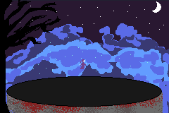

# orbits

Authors: Russell Fisher Completed on 11/2/2026

You get to control a necromancer summoning skulls that float around you! Pressing the A button summons skulls.
Pressing the start button resets the skulls. I hope you enjoy the animations I added to the character and background! 

Play it here! [https://roughhouserandy.github.io/orbits/]

An exercise for learning about header files in C++. See instructions [here](./instructions.md)
